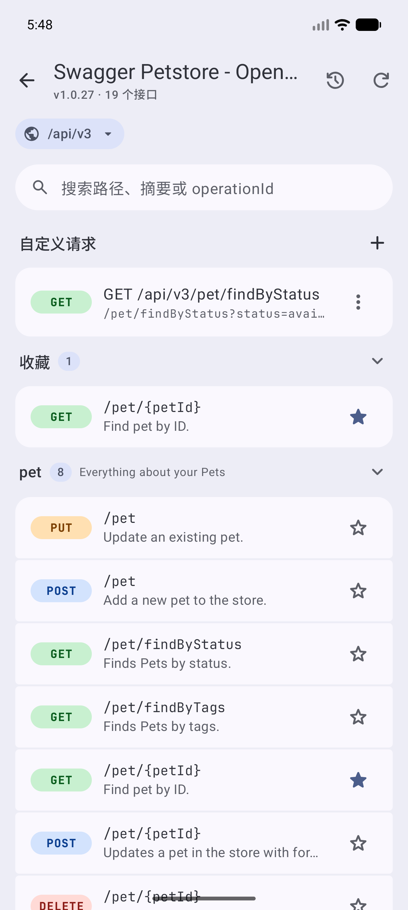
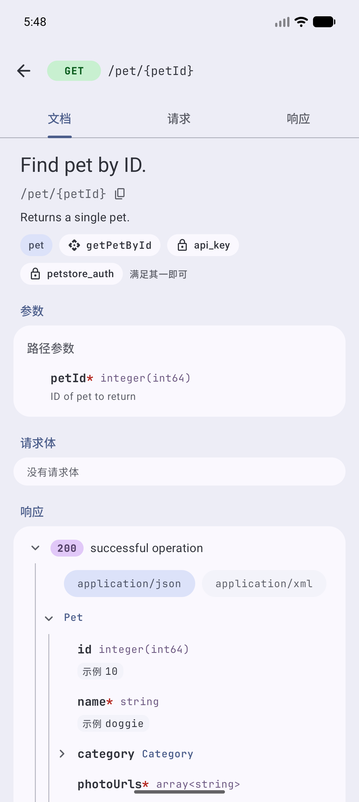
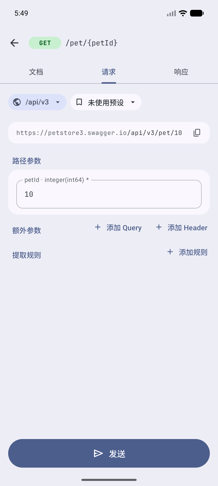
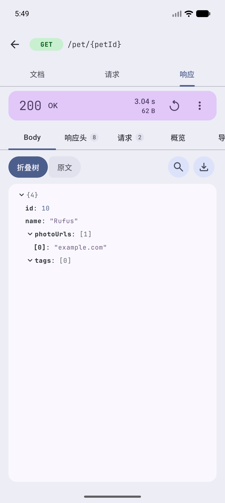

<div align="center">


# APInspector

在 Android 上浏览 OpenAPI 文档、发送请求、查看响应。

[](https://github.com/FooFishes/APInspector/actions/workflows/check.yml)
[](LICENSE)
[](#安装)
[](https://kotlinlang.org)
[](https://www.openapis.org)

</div>

<p align="center">
  
  
  
  
</p>

## 简介

APInspector 是一款 Android 应用。导入一份 OpenAPI 文档后，可以在手机或平板上浏览其中的接口、填写参数并发出请求，再查看完整的请求与响应。数据只保存在本机，不需要账号。

## 功能

- **导入 API 文档**：支持 OpenAPI 3.0 / 3.1 / 3.2 的 JSON 与 YAML，来源可以是本地文件、URL 或粘贴的文本。通过 URL 导入的文档可以手动刷新，刷新后会列出接口的增删改。
- **浏览接口**：按 tag 分组，支持搜索和收藏。文档页展示参数、请求体与响应的 schema 树，`$ref` 可以逐层展开。
- **发送请求**：根据 schema 生成参数和 Body 编辑器，覆盖 JSON、表单、multipart 与文件。每个接口会记住上次填写的参数，也可以另存为多组预设。
- **环境、变量与鉴权**：一份文档可以有多个环境，请求中用 `{{name}}` 引用变量。鉴权支持 Bearer、Basic 与 API Key；提取规则按 JSONPath 把响应里的值写回变量。
- **请求记录**：保存实际发出的请求和收到的响应，可以重放、恢复参数或复制为 cURL。响应详情包含 DNS、连接、TLS、首字节的耗时分解。
- **自定义请求**：不依赖文档直接向任意地址发请求，支持从 cURL 导入。
- **网络设置**：HTTP / SOCKS5 代理、超时、重定向、按环境跳过证书校验，每个环境有独立的 Cookie。
- **备份**：导出和导入全部数据，可以设置密码加密。
- **界面**：Material 3 Expressive，支持动态取色与深色模式，适配手机、折叠屏和平板。

目前不支持 Swagger 2.0、外部 `$ref`、OAuth2 授权流程和脚本，界面仅提供中文。完整的需求范围见 [docs/PRD.md](docs/PRD.md)。

## 安装

需要 Android 14（API 34）或更高版本。

预构建的 APK 随版本发布在 [Releases](https://github.com/FooFishes/APInspector/releases) 页面，也可以从源码构建：

```bash
git clone https://github.com/FooFishes/APInspector.git
cd APInspector
./gradlew :app:assembleDebug
```

构建需要 JDK 21 和 Android SDK，产物位于 `app/build/outputs/apk/debug/`。

## 快速上手

1. 点击首页右下角的 **+**，选择从 URL 导入，填入 `https://petstore3.swagger.io/api/v3/openapi.json`。
2. 打开导入的文档，选择一个接口，例如 `GET /pet/{petId}`。
3. 切到"请求"页填写参数，点击"发送"，结果显示在"响应"页。

## 项目结构

| 模块 | 说明 |
|---|---|
| `:openapi` | 纯 Kotlin / JVM 模块，不依赖 Android。包含 OpenAPI 解析器、领域模型、变量替换、cURL 解析与导出。 |
| `:app` | Android 应用。Jetpack Compose、Navigation 3、Hilt、Room、OkHttp。 |

更多背景：[产品需求](docs/PRD.md) · [术语表](GLOSSARY.md) · [架构决策记录](docs/adr/)

## 隐私

- 只申请网络权限。
- 不含统计、广告或崩溃上报 SDK。应用只会访问你导入文档时填写的 URL 和你发出的请求的目标地址。
- 数据不进入系统云备份，只能通过应用内的手动备份导出。

凭证的存储方式等安全相关说明见 [SECURITY.md](SECURITY.md)。

## 参与贡献

欢迎提交 Issue 和 Pull Request，开始之前请阅读 [CONTRIBUTING.md](CONTRIBUTING.md)。版本变更记录在 [CHANGELOG.md](CHANGELOG.md)。

## 许可证

本项目以 [GNU General Public License v3.0](LICENSE) 发布。

随项目分发的第三方内容沿用各自的许可证，文本见 [docs/licenses/](docs/licenses/)：

- [JetBrains Mono](https://www.jetbrains.com/lp/mono/) 字体：SIL Open Font License 1.1
- [Material Symbols](https://fonts.google.com/icons) 图标：Apache License 2.0
- [material-3-skill](https://github.com/hamen/material-3-skill)（`.claude/skills/material-3`）：MIT License
